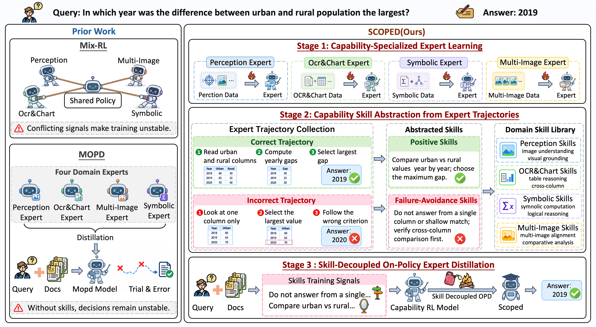

# SCOPED: Skill-Decoupled On-Policy Expert Distillation for Unified Vision-Language Models

<a name="paper"></a>

**SCOPED: Skill-Decoupled On-Policy Expert Distillation for Unified Vision-Language Models** 项目源码。

论文：待发布。

<div align="center">

[](#paper)
[](https://github.com/NEUIR/SCOPED)
[](https://huggingface.co/xiongyq/SCOPED-4B)
[](https://huggingface.co/xiongyq/SCOPED-8B)
[](https://huggingface.co/datasets/xiongyq/SCOPED-Train)
[](https://huggingface.co/datasets/xiongyq/SCOPED-Eval)
[](LICENSE)

[English](README.md) | [中文](README_zh.md)

</div>

<div align="center">

[📖 项目介绍](#overview) • [⚙️ 环境安装](#setup) • [⚡ 训练](#training) • [🔧 推理](#inference)<br>
[📃 评测](#evaluation) • [🚀 快速开始](#quick-start) • [📧 Contact](#contact)

</div>

<a name="overview"></a>

## 📖 项目介绍

SCOPED 是一个通过技能解耦的 on-policy 专家蒸馏整合视觉理解能力的框架。首先，通过强化学习训练能力专门化专家；随后，从各专家的成功与失败轨迹中抽象可复用技能；最后，以技能作为教师专属指导，通过 on-policy 蒸馏将多种能力整合到统一的学生模型中。



框架涵盖四类互补能力：**视觉感知**、**OCR 与图表理解**、**符号推理**和**多图推理**。训练后的学生模型可直接进行推理，无需额外的技能提示。

<a name="setup"></a>

## ⚙️ 环境安装

使用 Python 3.12、配备 NVIDIA GPU 的 Linux 环境及兼容的 CUDA 运行环境。首先克隆项目：

```bash
git clone https://github.com/NEUIR/SCOPED.git
cd SCOPED
```

在项目根目录安装两个环境：`.venv-rl` 用于专家强化学习，`.venv-scoped` 供 OPD、技能抽象、推理和评测共用。内置的 EasyR1 与 veRL 依赖版本不同，需要分别安装。

```bash
# Expert reinforcement learning.
python3.12 -m venv .venv-rl
.venv-rl/bin/python -m pip install -r requirements-rl.txt

# OPD, skill abstraction, inference and evaluation.
python3.12 -m venv .venv-scoped
.venv-scoped/bin/python -m pip install -r requirements.txt
```

启动脚本会自动选择各阶段对应的环境，无需手动激活。所需环境不存在时，脚本会停止并提示安装。

指定模型 ID 时，模型默认从 Hugging Face 下载，已有缓存会自动复用。训练和评测脚本会自动下载对应数据。请按实际硬件调整 GPU 设置：专家训练、技能抽象和评测默认使用四张 GPU，蒸馏默认使用八张。

<a name="training"></a>

## ⚡ 训练

> 使用已发布模型时，可以跳过训练，直接进入[推理](#inference)或[评测](#evaluation)。

训练流程基于 [EasyR1](https://github.com/hiyouga/EasyR1) 和 [veRL](https://github.com/verl-project/verl)，包含以下三个阶段。训练数据位于 [Hugging Face](https://huggingface.co/datasets/xiongyq/SCOPED-Train)。在 [scripts/train.sh](scripts/train.sh) 中设置基础模型和学生模型路径，各阶段配置位于 [configs/](configs/)。

### 阶段一：能力专门化专家学习

第一阶段在各自的能力数据上独立训练四类专家，分别学习视觉感知、OCR 与图表理解、符号推理和多图推理。所有专家从同一基础模型初始化，默认使用 `Qwen/Qwen3-VL-8B-Instruct`。

```bash
bash scripts/train.sh rl
# 只训练一个专家：
bash scripts/train.sh capability1
```

完整 RL 阶段会自动导出专家模型，供后续阶段使用。如需使用已有专家，在 [scripts/train.sh](scripts/train.sh) 中设置 `CAPABILITY1_TEACHER` 至 `CAPABILITY4_TEACHER`。

### 阶段二：从专家轨迹中抽象能力技能

第二阶段由各专家对自己在训练数据上生成的成功与失败轨迹进行反思，再将相关证据归纳为能力级技能，包含可复用的验证原则与失败规避指导。

```bash
bash scripts/train.sh skill
# 只提取一个专家的技能：
bash scripts/train.sh skill capability1
```

这一阶段为每类能力生成一个 `SKILL.md`，供对应教师在蒸馏时使用。

### 阶段三：技能解耦的 On-Policy 专家蒸馏

最后，学生生成 on-policy 回答，并学习由对应能力专家在技能指导下提供的监督。技能作为教师专属的特权指导，学生则从专家监督中学习统一的策略。

```bash
bash scripts/train.sh opd
```

前两个阶段产生的专家模型和技能会自动加载。可在 [scripts/train.sh](scripts/train.sh) 中设置 `STUDENT_MODEL`，指定学生的初始化模型。

<a name="inference"></a>

## 🔧 推理

使用已发布的 SCOPED 模型进行推理，先启动 vLLM 服务：

```bash
.venv-scoped/bin/vllm serve xiongyq/SCOPED-8B \
    --served-model-name scoped \
    --tensor-parallel-size 4 \
    --port 8000
```

可按需替换为 `xiongyq/SCOPED-4B` 或本地模型路径，并按硬件调整 `--tensor-parallel-size`。下方[快速开始](#quick-start)示例演示如何向该服务发送图片问题。

<a name="evaluation"></a>

## 📃 评测

可运行全部支持的基准，也可选择其中的评测集合。脚本会自动下载 [SCOPED-Eval](https://huggingface.co/datasets/xiongyq/SCOPED-Eval)，生成预测并报告各基准对应的指标。

```bash
bash scripts/eval.sh all
# 选择评测集合：
bash scripts/eval.sh chartqa,ccocrv2
# 更换模型：
MODEL=xiongyq/SCOPED-4B bash scripts/eval.sh all
```

默认模型为 `xiongyq/SCOPED-8B`。复用上面已经启动的服务：

```bash
BASE_URL=http://localhost:8000 bash scripts/eval.sh chartqa --served-model-name scoped
```

使用 `EVAL_OUT_DIR` 指定结果目录，传入 `--resume` 继续已有评测。

<a name="quick-start"></a>

## 🚀 快速开始

先启动[推理](#inference)部分的服务，将 `image.png` 替换为你的 PNG 图片，再运行以下示例。示例要求模型逐步推理，并将最终答案放在 `<answer>` 标签中。

```python
import base64
import json
from pathlib import Path
from urllib.request import Request, urlopen

image = base64.b64encode(Path("image.png").read_bytes()).decode()
payload = {
    "model": "scoped",
    "messages": [{
        "role": "user",
        "content": [
            {"type": "image_url", "image_url": {
                "url": f"data:image/png;base64,{image}"
            }},
            {"type": "text", "text": (
                "What is shown in this image? "
                "Please reason step by step, and put your final answer "
                "within <answer></answer>."
            )},
        ],
    }],
    "temperature": 0.0,
    "max_tokens": 2048,
}
request = Request(
    "http://localhost:8000/v1/chat/completions",
    data=json.dumps(payload).encode(),
    headers={"Content-Type": "application/json"},
)
with urlopen(request, timeout=600) as response:
    result = json.load(response)
print(result["choices"][0]["message"]["content"])
```

## 致谢

本项目基于 [EasyR1](https://github.com/hiyouga/EasyR1)、[veRL](https://github.com/verl-project/verl)、[vLLM](https://github.com/vllm-project/vllm) 和 [Qwen3-VL](https://github.com/QwenLM/Qwen3-VL)。感谢这些项目的贡献者开放代码与模型。

## 许可证

SCOPED 自有代码使用 [MIT](LICENSE) 许可证。内置的 EasyR1 和 veRL 代码保留其 Apache 2.0 许可证与声明，详见 [NOTICE](NOTICE)。

<a name="contact"></a>

## 📧 Contact

If you have questions, suggestions, and bug reports, please give us an issue or email:

```
yqxiong54@gmail.com
```
